# FYP360 database (ER diagram)

Supabase (PostgreSQL), `public` schema. Every table has Row Level Security on; changes to the workflow go through database functions.

```mermaid
erDiagram
    auth_users ||--|| profiles : "signs in as"

    profiles {
        uuid id PK "same as auth user"
        text role "admin / coordinator / supervisor / jury / group"
        text username
        text display_name
        text contact_email
        timestamptz created_at
    }

    groups {
        uuid id PK
        text code "FYP-2026-001"
        text name
        text section
        text batch
        text semester
        int max_members "default 4"
        text status "active / disqualified / dissolved"
        text status_reason
        timestamptz status_changed_at
        uuid supervisor_id FK
        uuid account_id FK "shared group login"
        text proposal_status
        uuid approved_proposal_id FK
        timestamptz created_at
    }

    group_members {
        uuid id PK
        uuid group_id FK
        text student_id
        text full_name
        text email "used for Google login"
        bool is_lead
        bool eligible "89 credit hours"
        timestamptz created_at
    }

    group_jury {
        uuid group_id PK, FK
        uuid jury_id PK, FK
    }

    proposals {
        uuid id PK
        uuid group_id FK
        int slot "1 to 3"
        text title
        text summary "abstract, 200-250 words"
        text objectives
        text outcomes
        text project_type
        text domain
        text_array tech_stack
        text apis
        text supervisor_note
        bool recommended
        timestamptz updated_at
    }

    proposal_events {
        bigint id PK
        uuid group_id FK
        uuid actor_id
        text actor_role
        text action
        text comment
        timestamptz created_at
    }

    class_sessions {
        uuid id PK
        uuid group_id FK
        text phase "fyp1 / fyp2"
        date held_on
        text topic
        uuid created_by
        timestamptz created_at
        timestamptz updated_at
    }

    session_attendance {
        uuid session_id PK, FK
        uuid member_id PK, FK
        text status "present / absent"
        numeric mark "out of 100"
    }

    evaluation_marks {
        uuid member_id PK, FK
        text component PK "proposal / fyp1_internal / fyp2_internal / external"
        numeric marks
        bool absent
        uuid entered_by
        timestamptz updated_at
    }

    group_declarations {
        uuid group_id PK, FK
        text phase PK
        uuid signed_by
        timestamptz signed_at
    }

    deliverables {
        uuid id PK
        text phase
        text title
        text description
        text kind "document / video"
        timestamptz due_at
        timestamptz created_at
    }

    deliverable_extensions {
        uuid deliverable_id PK, FK
        uuid group_id PK, FK
        timestamptz due_at
    }

    submissions {
        uuid id PK
        uuid deliverable_id FK
        uuid group_id FK
        int version
        text file_path "storage: submissions bucket"
        text file_name
        bigint file_size
        text mime_type
        text status "submitted / approved / changes_requested"
        text feedback
        uuid reviewed_by
        timestamptz reviewed_at
        timestamptz submitted_at
    }

    change_requests {
        uuid id PK
        uuid group_id FK
        text title
        text details
        text status "pending_jury / pending_coordinator / approved / rejected"
        uuid jury_by
        text jury_comment
        timestamptz jury_at
        uuid coord_by
        text coord_comment
        timestamptz coord_at
        timestamptz created_at
    }

    notifications {
        uuid id PK
        uuid group_id FK
        text kind
        text message
        timestamptz read_at
        timestamptz created_at
    }

    announcements {
        uuid id PK
        text title
        text body
        uuid created_by
        timestamptz created_at
    }

    password_reset_requests {
        uuid id PK
        text identifier
        text note
        text status
        uuid resolved_by FK
        timestamptz resolved_at
        timestamptz created_at
    }

    app_settings {
        text key PK "weights, pass mark, current phase..."
        text value
        timestamptz updated_at
    }

    audit_log {
        bigint id PK
        uuid actor_id
        text action
        text target
        jsonb details
        timestamptz created_at
    }

    profiles |o--o{ groups : "supervises"
    profiles |o--o| groups : "is login of"
    profiles ||--o{ group_jury : "judges"
    groups ||--o{ group_jury : "has jury"
    groups ||--o{ group_members : "has"
    groups ||--o{ proposals : "writes (max 3)"
    proposals |o--o| groups : "approved idea"
    groups ||--o{ proposal_events : "history"
    groups ||--o{ class_sessions : "meets in"
    class_sessions ||--o{ session_attendance : "records"
    group_members ||--o{ session_attendance : "attends"
    group_members ||--o{ evaluation_marks : "is marked"
    groups ||--o{ group_declarations : "signed per phase"
    deliverables ||--o{ submissions : "receives"
    groups ||--o{ submissions : "uploads"
    deliverables ||--o{ deliverable_extensions : "extended for"
    groups ||--o{ deliverable_extensions : "gets"
    groups ||--o{ change_requests : "asks"
    groups ||--o{ notifications : "receives"
    profiles |o--o{ password_reset_requests : "resolves"
```

## Notes
- **Standalone tables:** `announcements`, `app_settings` and `audit_log` have no foreign keys. Announcements reach groups through a trigger that writes `notifications`.
- **`*_by` columns** (`created_by`, `reviewed_by`, `entered_by`, `signed_by`, `jury_by`, `coord_by`) hold the staff member's `profiles.id`.
- **Marks:** FYP-1 = advisor 30 (average of `session_attendance.mark`) + proposal 10 + internal 60, ×0.4. FYP-2 = advisor 10 + internal 30 + external 20. Weights are in `app_settings`.
- **Files** live in the private Storage bucket `submissions`, at `<group_id>/<deliverable_id>/<file>`.
